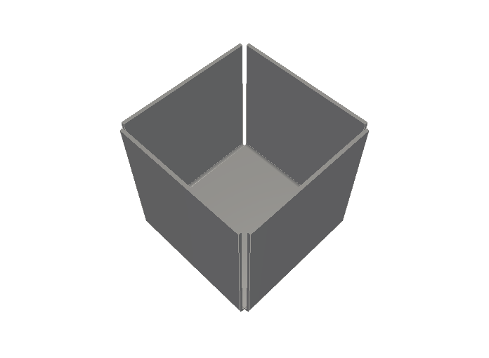
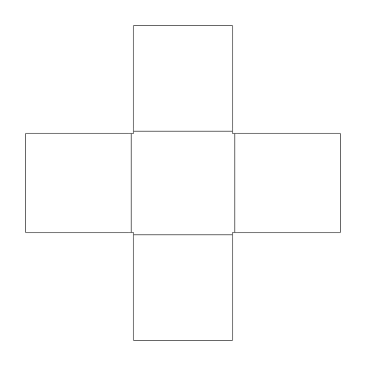

# PliCad

PliCad builds exact STEP models and flat patterns of sheet metal parts from
short text descriptions. The name comes from the Latin *plicare*, to fold. The
same root gives the word "complicated", and also "simple".

### Why

[FreeCAD](https://github.com/FreeCAD/FreeCAD) takes seconds to open a model, and
as long again to save, close or rebuild it. It carries gigabytes of code, uses
gigabytes of memory, and puts a large GUI in front of every task.
[OpenSCAD](https://github.com/openscad/openscad) reads text and starts fast, but
it builds triangle meshes, so every curve in its STEP files is an approximation.
The [OCCT](https://github.com/Open-Cascade-SAS/OCCT) library has three million
lines, and most of them are for free-form surfaces, foreign file formats,
documents and display. Sheet-metal parts need planes, cylinders, lines and arcs.

PliCad keeps the text and the speed, and adds exact geometry. It makes use of
the [classic rules](https://doi.org/10.1002/j.1538-7305.1978.tb02135.x):

1. Each program does one thing well. A new job gets a new program.
2. The output of each program can become the input of another. Programs read and
   write plain text and run non-interactively.
3. Every piece is tried early. Clumsy parts are thrown away and rebuilt.
4. Repeated work gets a tool, even if a detour is needed to build it.
5. Executables stay small and start in milliseconds. Tens or hundreds of
   megabytes of executable code are insane.

### Programs

| Program   | Job                                                            |
|-----------|----------------------------------------------------------------|
| smfold    | Folds a part description into a solid                          |
| smflat    | Writes the flat pattern as DXF                                 |
| tostep    | Writes a solid as STEP                                         |
| measure   | Prints volume, bounding box, area and holes, one item per line |
| place     | Positions parts from an assembly file                          |
| interfere | Prints one line for each pair of colliding parts               |
| assemble  | Replays the assembly sequence, checking each insertion path    |
| numdiff   | Compares two outputs of measure within tolerances              |
| param     | Prints the values of the names of a source file                |
| family    | Writes the part source of a screw, insert or package of a table |
| extrude   | Makes solids of outlines pushed along an axis, with a draft    |
| bool      | Unites, subtracts and intersects solids                        |
| fillet    | Rounds the edges of solids, as a ball rolls along them         |
| mold      | Reports the walls, the drafts and the undercuts along a pull   |
| smview    | Projects a part into the lines of its drawing views            |
| smdim     | Adds dimensions and callouts to a view                         |
| smsheet   | Lays views on sheets as PostScript, with title block           |
| tomesh    | Writes the triangles of parts as an OBJ mesh                   |
| view      | Shows meshes and pictures in a window; a click names the part  |
| schdraw   | Draws a schematic sheet as plain vectors                       |
| schnet    | Writes the netlist of a schematic sheet                        |
| schcheck  | Checks a netlist for what a schematic leaves undone            |
| netdiff   | Compares two netlists by their circuits, not their names       |
| schview   | Shows a schematic sheet in a window                            |
| pcbplace  | Places the parts of a board as its source says                 |
| pcbroute  | Routes the copper of a board as its source says                |
| pcbcheck  | Checks the copper of a board against its netlist and rules     |
| pcbgerber | Writes the Gerber and drill files of a board                   |
| pcbvec    | Writes the layers of a board as plain vectors                  |
| gbrvec    | Turns a Gerber or Excellon file into plain vectors             |
| pcbview   | Shows the layers of a board in a window                        |
| vecps     | Draws vector files as pages of PostScript                      |

### Usage

To build the programs and run tests:

```sh
make            # Build the programs
make check      # Headers and text rules, format and cppcheck
make tidy       # Clang-tidy, before a commit
make -C test     # Every test, each group in its budget
make -C test GROUPS='parts bad'   # Some groups, as test/run.sh lists them
```

All source files share one language, described in `man 7 plicad`: one statement
per line, `#` comments, a trailing `\` to continue a line, `NAME = EXPR`
definitions, and `include FILE` to share them. Lengths are in mm unless a number
ends in `in`, and angles are in degrees. Each length and angle of a definition
has a tolerance, `NAME = EXPR +- TOL` or that of a `tolerance LEN ANGLE`
statement of its file of parameters, and the drawings print the tolerances of
their dimensions from it. Every program reads and writes one text format, the
stream of stream(5).

For example, an open cube can be described as follows:

```
S = 50 # outer edge length, mm
t = 1 # sheet thickness
r = 1 # inside bend radius
tr = t + r # setback of a 90 degree bend
sheet t r 0.44
plate base tr tr S-tr S-tr at 0 S 0 axes +x -y
flange left base -x -90 S-tr
flange right base +x -90 S-tr
flange front base -y -90 S-tr
flange back base +y -90 S-tr
```

The base plate is the center of a cross-shaped blank. Four walls fold up from
its edges to the full height, and the top stays open.

Convert it to STEP (folded) and DXF (flat):

```sh
build/smfold cube.sm > cube.st
build/tostep cube.st > cube.step
build/smflat -f dxf cube.st > cube.dxf
```

and draw it on a B sheet, by the views of `test/cube.draw`, each at its own
scale:

```sh
build/smsheet -v test/cube.draw | build/smview cube.st | build/smdim |
    build/smsheet test/cube.draw - > cube.ps
```

Use your favorite STEP/DXF viewer to take a look at the output:

```sh
f3d cube.step --output=cube.png --resolution=600,440 --no-config \
    --up=+Z --camera-direction=-1,1,-2 --background-color=1,1,1
inkscape cube.dxf --export-area-drawing --export-type=png \
    --export-filename=cube.flat.png --export-background=white \
    --export-background-opacity=1 --export-height=400
```



The programs are in `src/`, their manual pages in `man/`, and the
library in `lib/`: materials and finishes, the templates of drawings,
and standard tables of screws, holes, inserts, bends and packages
(`man 7 plicad-lib`). The tests and their fixtures are in `test/`.

### Contributing

- Strict ISO C99. GCC runs with all applicable warnings as errors.
- The programs link dynamically to two libraries, the system C library and libm.
  The viewers (view, schview, pcbview) link X11, GL and Xinerama as well.
- The code follows the [Linux coding
  style,](https://github.com/torvalds/linux/blob/master/Documentation/process/coding-style.rst)
  with a few exceptions (e.g. use `//` comments only, and braces around every
  statement body).
- Comments follow the rules of STYLE.md at
  <https://embd.cc/ai-abuse-of-the-active-voice>, esp. rules 1 and 2.
