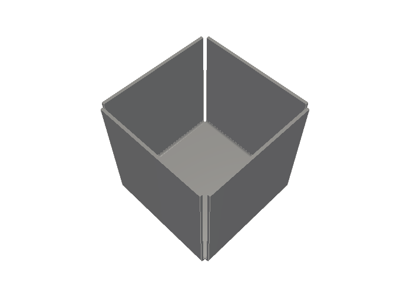
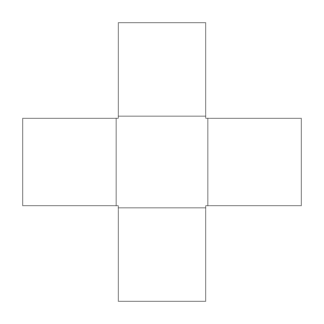

# PliCad

PliCad builds exact STEP models and flat patterns of sheet metal parts from
short text descriptions. The name comes from the Latin *plicare*, to fold. The
same root gives the word "complicated", and also "simple".

### Why

[FreeCAD](https://github.com/FreeCAD/FreeCAD) takes seconds to open a model, and
as long again to save, close or rebuild it. It carries gigabytes of code, uses
gigabytes of memory, and puts a large GUI in front of every task.
[OpenSCAD](https://github.com/openscad/openscad) reads text and starts fast, but
it builds triangle meshes, so every curve in its STEP files is an approximation.
The [OCCT](https://github.com/Open-Cascade-SAS/OCCT) library has three million
lines, and most of them are for free-form surfaces, foreign file formats,
documents and display. Sheet-metal parts need planes, cylinders, lines and arcs.

PliCad keeps the text and the speed, and adds exact geometry. It makes use of
the [classic rules](https://doi.org/10.1002/j.1538-7305.1978.tb02135.x):

1. Each program does one thing well. A new job gets a new program.
2. The output of each program can become the input of another. Programs read and
   write plain text and run non-interactively.
3. Every piece is tried early. Clumsy parts are thrown away and rebuilt.
4. Repeated work gets a tool, even if a detour is needed to build it.
5. Executables stay small and start in milliseconds. Tens or hundreds of
   megabytes of executable code are insane.

### Programs

| Program   | Job                                                            |
|-----------|----------------------------------------------------------------|
| smfold    | Folds a part description into a solid                          |
| smflat    | Writes the flat pattern as DXF                                 |
| tostep    | Writes a solid as STEP                                         |
| measure   | Prints volume, bounding box, area and holes, one item per line |
| place     | Positions parts from an assembly file                          |
| interfere | Prints one line for each pair of colliding parts               |
| numdiff   | Compares two outputs of measure within tolerances              |
| lint      | Checks the text of each source file against the house rules    |

### Usage

To build the programs and run tests:

```sh
make            # Build the programs
make check      # Headers and text rules, format and cppcheck
make sizes      # Report the size of each program
make tidy       # Clang-tidy, before a commit
test/run.sh     # Every test, under sanitizers
test/run.sh parts bad   # Some groups of tests, as test/run.sh lists them
```

For example, an open cube can be described as follows:

```
S = 50                  # outer edge length, mm
t = 1                   # sheet thickness
r = 1                   # inside bend radius
tr = t + r              # setback of a 90 degree bend
sheet t r 0.44
plate base tr tr S-tr S-tr origin 0 S 0 axes +x -y
flange left base -x -90 S-tr
flange right base +x -90 S-tr
flange front base -y -90 S-tr
flange back base +y -90 S-tr
```

The base plate is the centre of a cross-shaped blank. Four walls fold up from
its edges to the full height, and the top stays open.

Convert it to STEP (folded) and DXF (flat):

```sh
build/smfold cube.sm > cube.fold
build/tostep cube.fold > cube.step
build/smflat -f dxf cube.fold > cube.dxf
```

Use your favorite STEP/DXF viewer to take a look at the output:

```sh
f3d cube.step --output=cube.png --resolution=600,440 --no-config \
    --up=+Z --camera-direction=-1,1,-2 --background-color=1,1,1
inkscape cube.dxf --export-area-drawing --export-type=png \
    --export-filename=cube.flat.png --export-background=white \
    --export-background-opacity=1 --export-height=400
```



### Contributing

- Strict ISO C99. GCC runs with all applicable warnings as errors.
- The programs link dynamically to two libraries, the system C library and libm.
- The code follows the [Linux coding
  style,](https://github.com/torvalds/linux/blob/master/Documentation/process/coding-style.rst)
  with a few exceptions (e.g. use `//` comments only, and braces around every
  statement body).
- Comments follow the rules of STYLE.md at
  <https://embd.cc/ai-abuse-of-the-active-voice>, esp. rules 1 and 2.
